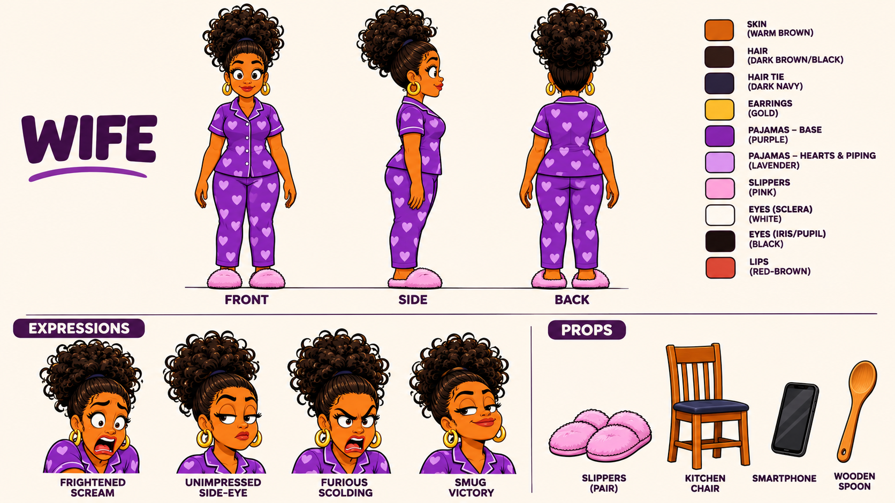
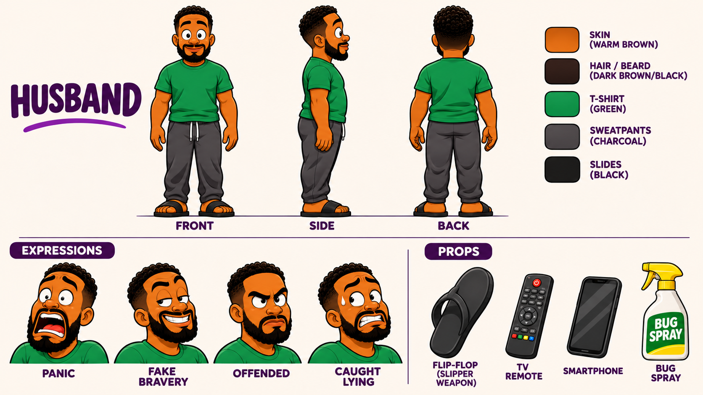
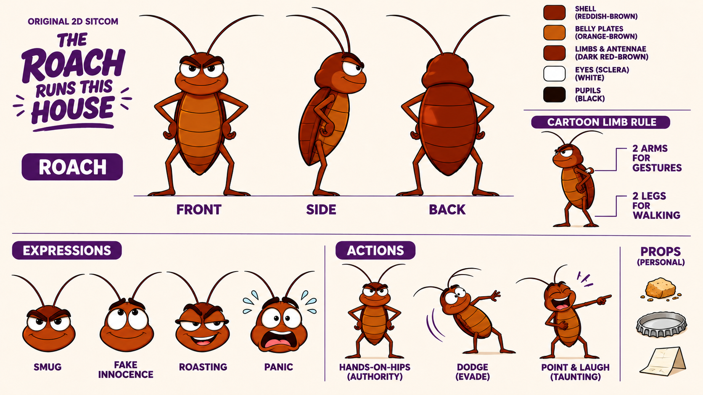
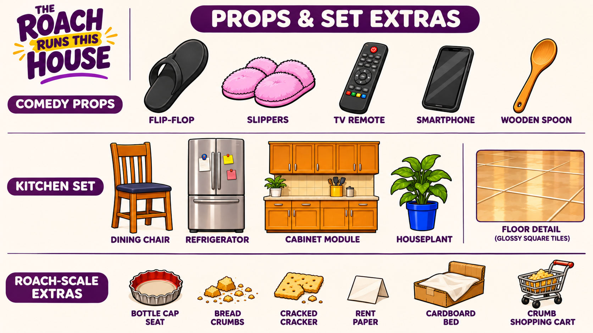
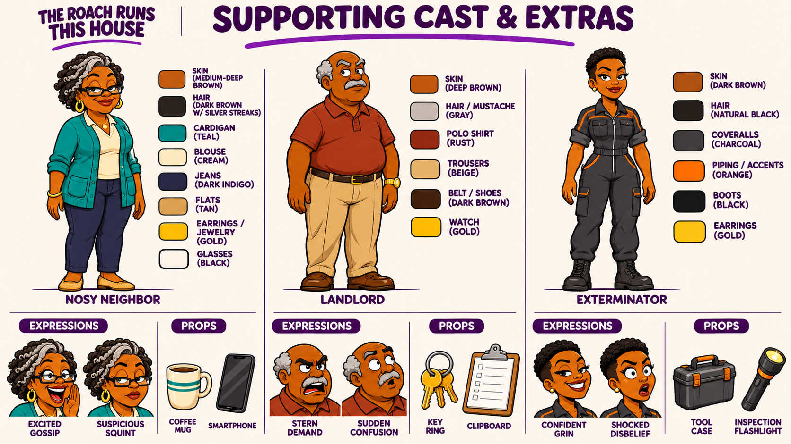

# The Roach Runs This House — visual reference pack

Added November 6, 2026 at Christopher's request. These are the five finished visual-development sheets. The earlier roach sheet with inconsistent limbs is excluded.

## Wife

Front/side/back turnarounds, four expressions, palette and personal props.

## Husband

Front/side/back turnarounds, four expressions, palette and personal props.

## Roach

Corrected cartoon limb rule, turnarounds, expressions, action poses and tiny props.

## Props and set extras

Recurring comedy props, kitchen objects, floor detail and roach-scale accessories.

## Supporting cast

Proposed nosy neighbor, landlord and exterminator, each with expressions and props.

## Continuity rules

- Wife: original face and warm skin tone, high curly puff, gold hoops, purple heart-print pajamas and pink fluffy slippers.
- Husband: original face, short tapered curls, full beard, green shirt, charcoal drawstring pants and black slides. Keep the hand-held flip-flop distinct from his slide sandals.
- Roach: reddish-brown segmented shell, orange-brown belly, two antennae, expressive eyes and smug grin. The simplified cartoon model has two arms and two legs; do not add realistic insect legs.
- Preserve the warm kitchen, bold ink contours and rich 2D cel shading. Use expression references without changing facial identity.
- Supporting characters are proposed additions, not replacements for the main trio. Keep them visually distinct and introduce them only when an episode calls for them.
- Props are reference drawings, not transparent cutouts or layered animation rigs. Roach-scale items are shown separately and are not human-scale objects.

## Production use

Use the matching character sheet for identity and the props sheet for object consistency when preparing a shot. Prepare one clean scene frame per shot; do not feed an entire multi-view sheet as a literal opening video frame. Animate only the active speaker's mouth and keep other reactions silent.

This commit adds reference artwork only. It does not update `characters.yaml`, `studio/rigs.py`, the existing rig lock, episode sources or previous renders. The old code-generated rigs do not automatically acquire these appearances. No character approval/QC flags have been edited, and no render or test pass is claimed for this asset-only change.

## Source record

Created with ChatGPT image generation from Christopher's supplied kitchen/cast reference. The supporting cast was developed as optional extras. See `../../LICENSES.yaml` and the repository's `LICENSE` for provenance and project use. No private Library URLs or local machine paths are needed to use this pack.
